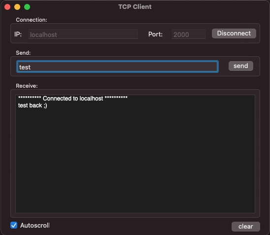

# Initiator – Simple TCP Client GUI

A simple SwiftUI app (macOS, iPhone, iPad) to connect to TCP servers and send/receive text based messages. JSON payloads are shown as a tree, with a raw/processed toggle and text export. 

  

Also see [TCP Server](https://github.com/voelkerb/TCPServer).